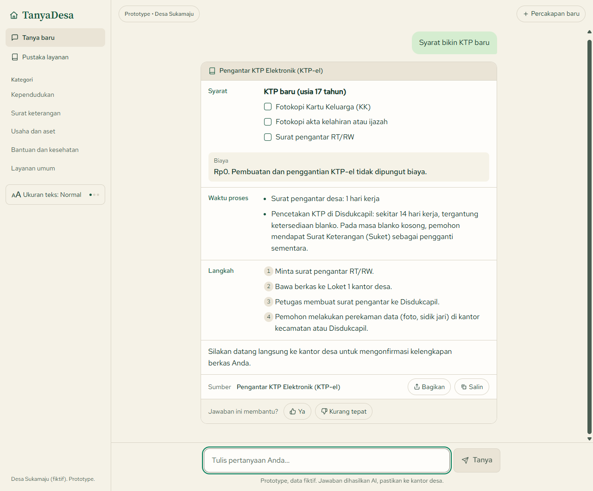
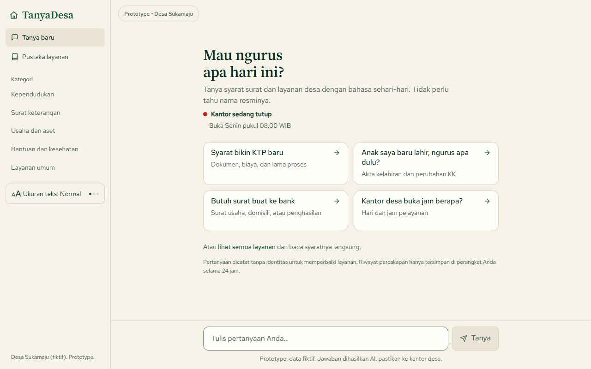
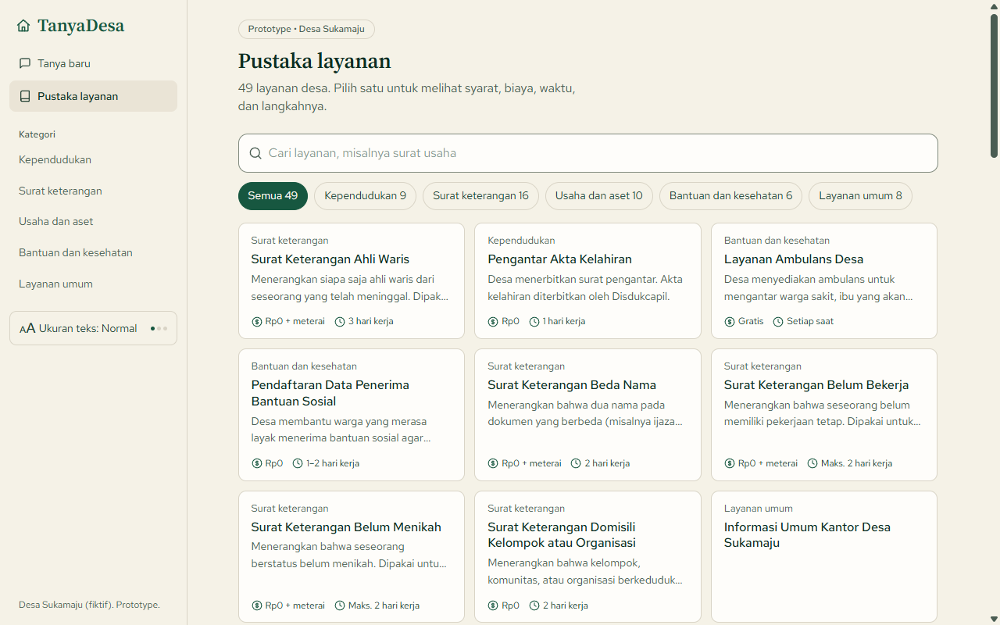
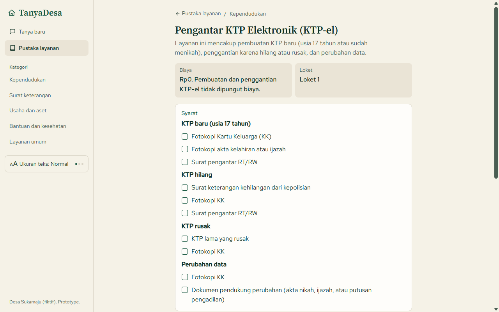
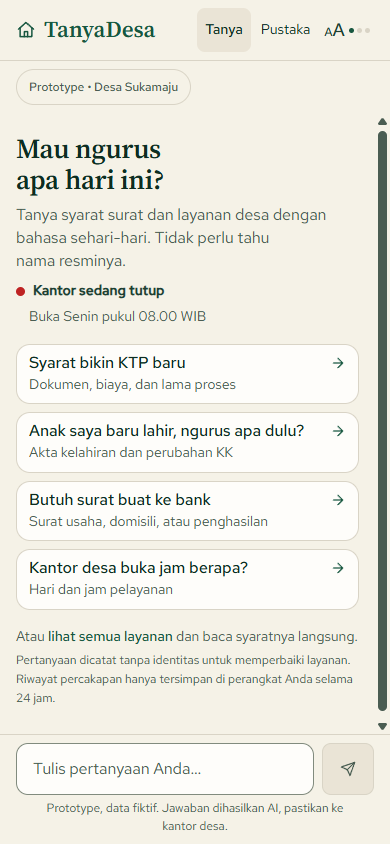
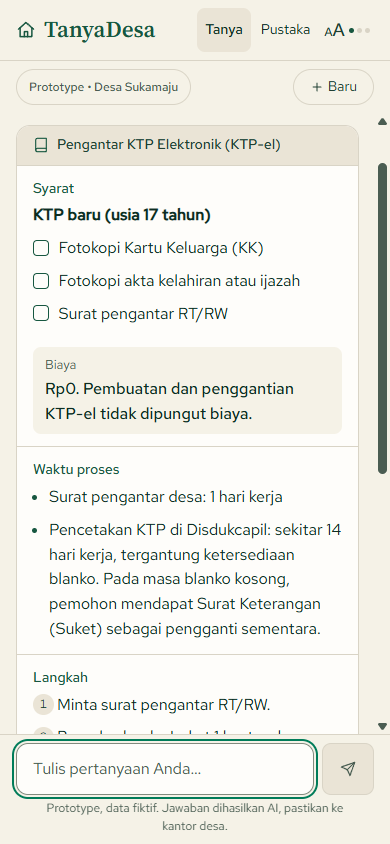
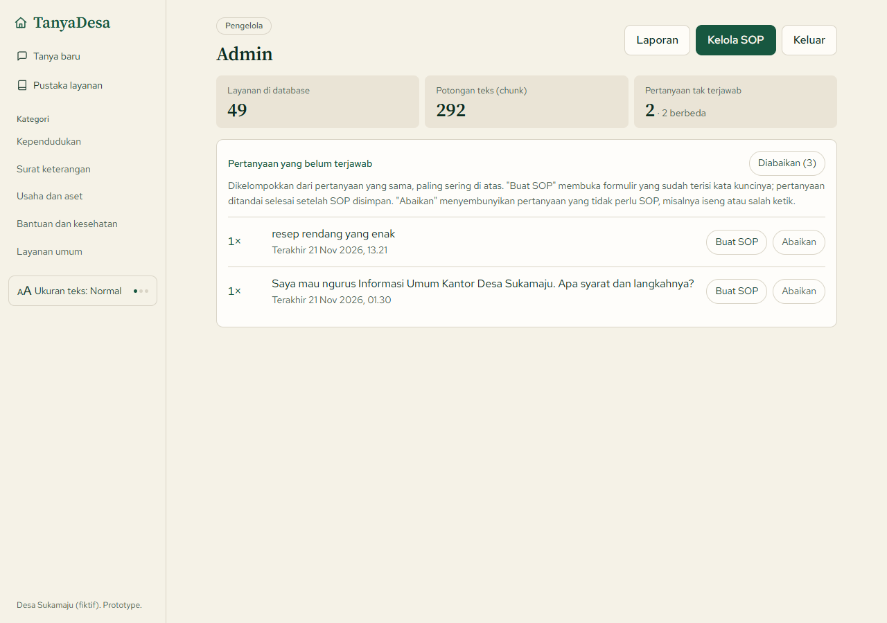
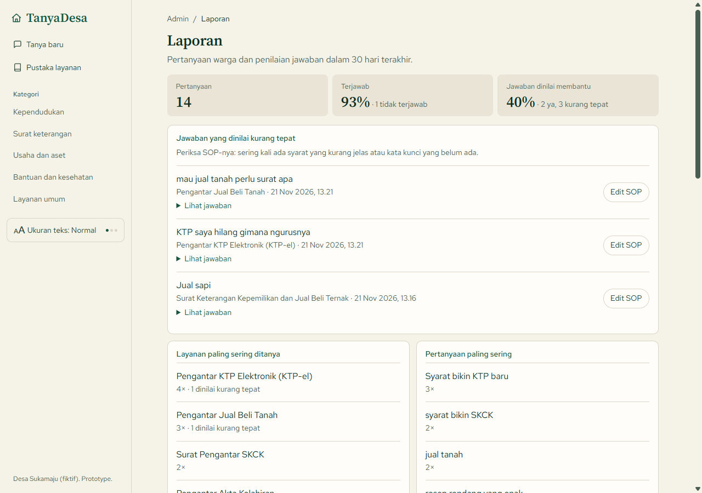
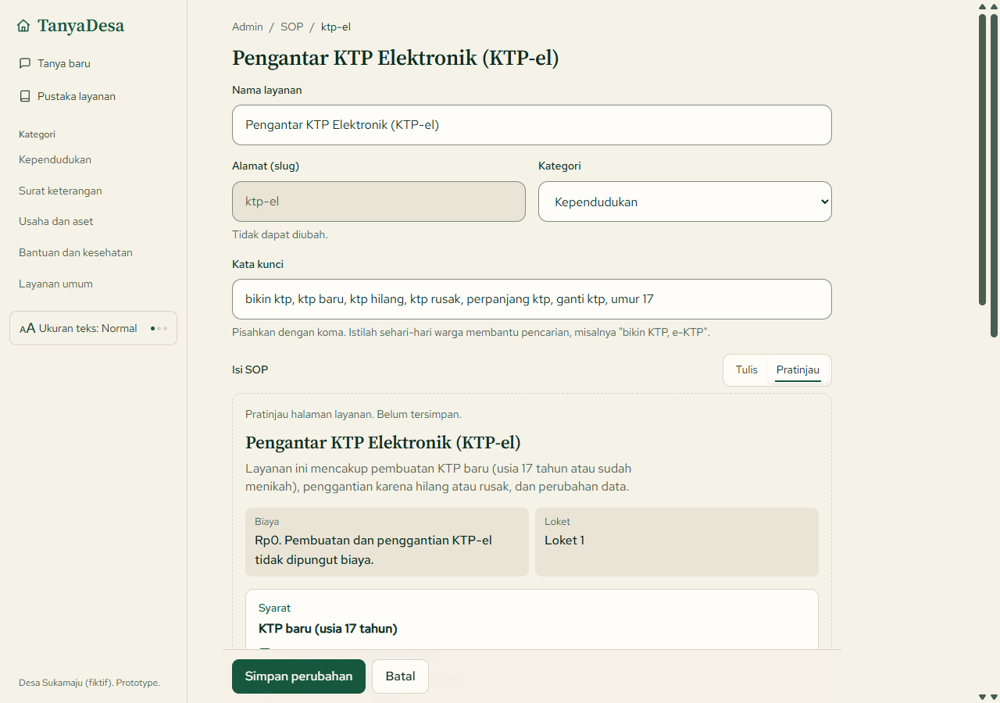
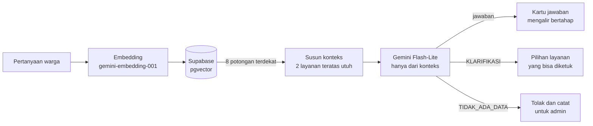

# TanyaDesa

Asisten AI dan pustaka layanan untuk administrasi desa. Warga bertanya dengan bahasa sehari-hari ("anak saya baru lahir, ngurus apa dulu?") dan mendapat syarat, biaya, waktu, serta langkah yang diambil dari SOP desa, bukan dari tebakan model.

> **Prototype dengan data fiktif.** Desa Sukamaju, nomor telepon, dan 49 SOP di dalamnya dibuat untuk percobaan. Jangan dipakai sebagai rujukan layanan nyata.

**Coba langsung: [tanyadesa.vercel.app](https://tanyadesa.vercel.app)**

<p align="center">
  
</p>

## Isi

- [Apa yang bisa dilakukan](#apa-yang-bisa-dilakukan)
- [Tampilan](#tampilan)
- [Cara kerja](#cara-kerja)
- [Teknologi](#teknologi)
- [Menjalankan di komputer sendiri](#menjalankan-di-komputer-sendiri)
- [Evaluasi jawaban](#evaluasi-jawaban)
- [Struktur proyek](#struktur-proyek)
- [Keputusan desain](#keputusan-desain)
- [Keterbatasan](#keterbatasan)
- [Lisensi](#lisensi)

## Apa yang bisa dilakukan

**Untuk warga**

- Tanya syarat dan langkah layanan dengan kalimat biasa. Jawaban mengalir bertahap, dengan syarat sebagai daftar centang, biaya dan waktu sebagai petak, dan sumber SOP di bawahnya.
- Pertanyaan yang terlalu umum ("mau urus berkas") dijawab dengan pertanyaan balik berupa pilihan yang bisa diketuk.
- Pertanyaan di luar cakupan ditolak, disertai tombol Telepon, WhatsApp, dan Peta serta status kantor buka atau tutup.
- Saran pertanyaan lanjutan ("Biayanya berapa?"), penilaian jempol, bagikan lewat WhatsApp, dan salin jawaban.
- Pustaka 49 layanan dengan pencarian dan filter kategori, halaman detail per layanan, serta tanggal pembaruan.
- Riwayat percakapan tersimpan di perangkat selama 24 jam, ukuran teks bisa diperbesar, dan bisa dipasang di layar utama ponsel (PWA).

**Untuk pengelola desa** (`/admin`, dilindungi kata sandi)

- Daftar pertanyaan yang tidak terjawab, paling sering di atas. Satu ketukan membuka formulir SOP baru yang sudah terisi kata kuncinya.
- Tambah, ubah, dan hapus SOP langsung dari browser, dengan pratinjau halaman layanan. Indeks pencarian diperbarui otomatis saat disimpan.
- "Coba tanya": menjalankan pertanyaan lewat mesin jawaban yang sama untuk memeriksa SOP yang baru diubah.
- Laporan 30 hari: jumlah pertanyaan, persen terjawab, kepuasan, jawaban yang dinilai kurang tepat (langsung ke SOP terkait), serta layanan dan pertanyaan paling sering.

## Tampilan

| Beranda | Pustaka layanan |
|---|---|
|  |  |

| Detail layanan | Di ponsel |
|---|---|
|  |   |

**Halaman admin**

| Dasbor | Laporan |
|---|---|
|  |  |

<p align="center">
  
</p>

## Cara kerja

TanyaDesa memakai RAG (retrieval-augmented generation): model hanya boleh menjawab dari teks SOP yang diambil untuk pertanyaan itu.



1. **Embedding.** Pertanyaan diubah menjadi vektor 768 dimensi. Bila ini lanjutan dari pertanyaan balik, pertanyaan sebelumnya ikut digabung.
2. **Pencarian.** Fungsi `match_sop_chunks` mengambil 8 potongan SOP terdekat (kemiripan kosinus, ambang 0,5).
3. **Konteks.** Lima potongan teratas dipakai, lalu semua potongan milik dua layanan teratas dimuat utuh. Ini mencegah daftar syarat terpotong dan membuat model melihat dua kandidat saat pertanyaannya ambigu.
4. **Jawaban terbatas.** Prompt sistem mewajibkan jawaban hanya dari konteks, daftar syarat selengkapnya, dan satu dari tiga hasil: jawaban, `KLARIFIKASI: pertanyaan | opsi | opsi`, atau `TIDAK_ADA_DATA`. Opsi klarifikasi divalidasi terhadap nama layanan sungguhan, jadi model tidak bisa mengarang pilihan.
5. **Pagar pertanyaan spesifik.** Bila pertanyaan sudah menyebut layanan dengan jelas ("syarat SKCK"), model diminta langsung menjawab dan tidak bertanya balik.
6. **Streaming.** Server membalas dalam baris JSON (NDJSON). Teks mengalir ke layar, sementara balasan khusus (klarifikasi dan penolakan) ditahan sampai lengkap agar warga tidak melihat awalan mentah.
7. **Pencatatan.** Setiap pertanyaan, hasil, dan penilaian dicatat tanpa identitas. Pertanyaan yang ditolak masuk daftar kerja admin.

SOP ditulis sebagai markdown per layanan (`data/sop/*.md` sebagai bahan awal) dan disimpan di tabel `sop_services`. Dipecah per bagian `##` menjadi potongan yang masing-masing di-embedding.

## Teknologi

| Lapisan | Pilihan |
|---|---|
| Aplikasi | Next.js 15 (App Router), React 19, TypeScript |
| Gaya | Tailwind CSS v4 (token desain sendiri), Source Serif 4 dan Red Hat Text |
| Basis data | Supabase (PostgreSQL) dengan pgvector dan indeks HNSW |
| Model | Gemini: `gemini-flash-lite-latest` untuk jawaban, `gemini-embedding-001` untuk embedding |
| Hosting | Vercel (deploy otomatis dari `main`) |

Tidak ada pustaka UI, pustaka markdown, atau SDK AI tambahan. Panggilan ke Gemini memakai `fetch` biasa.

## Menjalankan di komputer sendiri

Butuh Node.js 20 atau lebih baru, proyek Supabase, dan kunci API Gemini.

```bash
git clone https://github.com/cahyata/tanyadesa.git
cd tanyadesa
npm install
cp .env.example .env.local
```

1. Isi `.env.local`:

   | Variabel | Keterangan |
   |---|---|
   | `GEMINI_API_KEY` | Kunci dari Google AI Studio |
   | `NEXT_PUBLIC_SUPABASE_URL` | URL proyek Supabase |
   | `SUPABASE_SERVICE_ROLE_KEY` | Kunci service role. Hanya dipakai di server, jangan dibagikan |
   | `ADMIN_PASSWORD` | Kata sandi `/admin`. Kosong berarti admin nonaktif. Pakai yang panjang dan unik |

2. Buat tabel: jalankan isi [`supabase/schema.sql`](supabase/schema.sql) di SQL Editor Supabase.
3. Isi SOP dan indeksnya (butuh beberapa menit; skrip menunggu sendiri bila kuota per menit Gemini habis):

   ```bash
   npm run ingest
   ```

4. Jalankan:

   ```bash
   npm run dev
   ```

   Buka http://localhost:3000. Panel admin ada di http://localhost:3000/admin.

Perintah lain:

| Perintah | Fungsi |
|---|---|
| `npm run ask -- "syarat bikin KTP baru"` | Uji satu pertanyaan dari terminal |
| `npm run eval` | Jalankan 62 pertanyaan uji dan tulis `eval/RESULTS.md` |
| `npm run ingest -- --force` | Timpa semua SOP di database dari berkas `data/sop` |
| `npm run typecheck` | Periksa tipe TypeScript |

`npm run ingest` tidak menimpa layanan yang sudah ada, supaya suntingan lewat admin tidak hilang.

## Evaluasi jawaban

`eval/questions.json` berisi 62 pertanyaan: 46 yang harus dijawab benar (dengan fakta kunci yang harus muncul), 10 di luar cakupan yang harus ditolak, dan 6 ambigu yang harus dijawab dengan pertanyaan balik.

Hasil terakhir ([rincian](eval/RESULTS.md)): **60 dari 62 (97%)**.

| Kategori | Lulus | Total |
|---|---|---|
| Pertanyaan biasa | 44 | 46 |
| Di luar cakupan | 10 | 10 |
| Ambigu | 6 | 6 |

Dua kegagalan itu: satu terkena batas kuota Gemini (429), satu lagi gagal sekali lalu lulus saat diulang, jadi kemungkinan variasi keluaran model. Pertanyaan ditulis oleh pembuat proyek yang sudah melihat SOP-nya, jadi angkanya cenderung optimistis. Uji yang lebih andal: minta orang lain menulis pertanyaan tanpa membuka SOP.

## Struktur proyek

```
app/
  page.tsx               Beranda chat
  layanan/               Pustaka dan halaman detail (dibangun statis dari database)
  admin/                 Dasbor, kelola SOP, laporan (dilindungi kata sandi)
  api/ask/               Endpoint jawaban (streaming NDJSON)
  api/feedback/          Penilaian jempol
components/              Chat, pustaka, formulir SOP, tombol ukuran teks, dan lainnya
lib/
  rag.ts                 Pencarian, prompt, klarifikasi, pencatatan
  gemini.ts              Klien Gemini (embedding, generate, stream)
  sop-parse.ts           Parser markdown SOP (murni, dipakai juga di pratinjau admin)
  sop-index.ts           Simpan SOP dan bangun indeks pencarian
  office.ts              Data kantor dan status buka/tutup
data/sop/                49 SOP awal (markdown)
scripts/                 ingest, ask, eval
eval/                    Pertanyaan uji dan hasil
supabase/schema.sql      Skema database
```

## Keputusan desain

- **Jawaban hanya dari SOP.** Lebih baik menolak daripada salah menyebut syarat atau biaya. Itu sebabnya ada jalur `TIDAK_ADA_DATA` dan daftar admin untuk menutup celahnya.
- **Pertanyaan ambigu dijawab dengan pilihan.** Pilihan layanan yang bisa diketuk divalidasi terhadap nama layanan di database, jadi model tidak menebak.
- **SOP disimpan di database.** Pengelola desa bisa mengubah SOP tanpa deploy. Halaman publik tetap statis dan dibangun ulang otomatis saat SOP berubah.
- **Admin sederhana.** Satu kata sandi dari variabel lingkungan, cookie sesi HMAC (`httpOnly`, `sameSite=strict`, aman di produksi), perbandingan waktu-konstan, dan pembatas percobaan login. Cukup untuk prototype, belum untuk banyak pengelola.
- **Animasi mengikuti pengaturan "kurangi gerakan".** Pengguna yang mengaktifkannya tidak mendapat animasi gerak.

## Keterbatasan

- **Data fiktif.** Semua SOP, nomor telepon, dan alamat adalah contoh.
- **Pembatas permintaan per instance.** Disimpan di memori proses, jadi di Vercel (serverless) mudah dilewati. Perlu penyimpanan bersama seperti Redis bila situs ramai.
- **Admin satu kata sandi.** Tidak ada catatan siapa mengubah apa, dan tidak ada riwayat versi SOP.
- **Hari libur nasional.** Status buka/tutup kantor belum memperhitungkannya.
- **Bahasa dan koneksi.** Hanya bahasa Indonesia, dan butuh internet (belum ada cache offline).
- **Kuota Gemini gratis terbatas.** Pada beban tinggi permintaan bisa ditolak dengan galat 429.

## Lisensi

[MIT](LICENSE). Kode dan SOP contoh boleh dipakai, diubah, dan disebarkan ulang dengan menyertakan pemberitahuan hak cipta. SOP di `data/sop/` adalah data fiktif, jadi sesuaikan dengan aturan desa Anda sebelum dipakai untuk layanan nyata.
